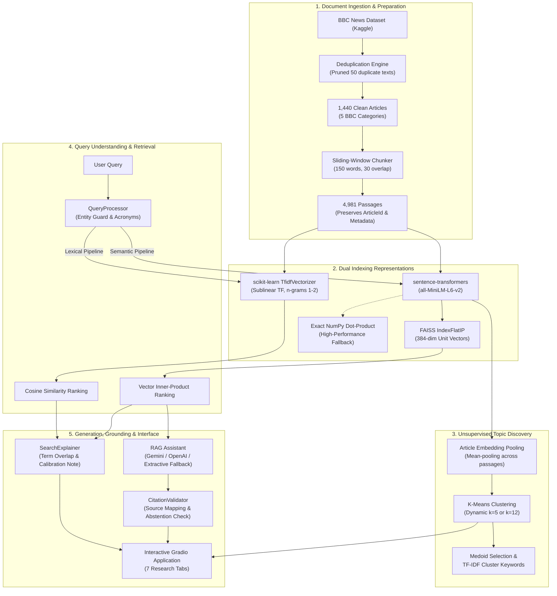

# DocuSense: Semantic Search, Similarity Index & RAG Assistant

[](https://www.nust.na)
[](https://www.nust.na)
[](https://www.python.org/)
[](https://huggingface.co/sentence-transformers/all-MiniLM-L6-v2)
[](https://github.com/facebookresearch/faiss)
[](https://gradio.app/)

> **NAT820S: Natural Language Processing and Applications — Semester 2, 2026**  
> **Department of Computer Science | Faculty of Computing and Informatics**  
> **Namibia University of Science and Technology (NUST), Windhoek, Namibia**  
> **Lecturer:** Mr. Naftali N. Indongo (`nindongo@nust.na`)  
>
> **Project Group Members (Project 2):**
> 1. **Gift Mubita** (Student ID: `222009632`)
> 2. **Romario Arnat** (Student ID: `221011056`)
> 3. **Maria Shikwambi** (Student ID: `222064374`)
> 4. **Adam Noa** (Student ID: `214018687`)

---

## Table of Contents

- [1. Project Overview & Challenge](#1-project-overview--challenge)
- [2. System Architecture](#2-system-architecture)
- [3. Dedicated Section: Models & Why They Were Chosen](#3-dedicated-section-models--why-they-were-chosen)
- [4. Model & Component Comparison Table](#4-model--component-comparison-table)
- [5. Dataset & Preprocessing Pipeline](#5-dataset--preprocessing-pipeline)
- [6. Repository Directory Structure](#6-repository-directory-structure)
- [7. Installation & Execution Guide](#7-installation--execution-guide)
- [8. Quantitative Evaluation & Empirical Findings](#8-quantitative-evaluation--empirical-findings)
- [9. Grounded RAG Assistant & Citation Verification](#9-grounded-rag-assistant--citation-verification)
- [10. Unsupervised Topic Discovery & Clustering](#10-unsupervised-topic-discovery--clustering)
- [11. Interactive Gradio User Interface](#11-interactive-gradio-user-interface)
- [12. Google Colab Reproducibility](#12-google-colab-reproducibility)
- [13. Ethical Considerations & Responsible AI](#13-ethical-considerations--responsible-ai)
- [14. Academic Integrity & AI Tool Usage Disclosure](#14-academic-integrity--ai-tool-usage-disclosure)

---

## 1. Project Overview & Challenge

### The Problem
Finding specific information across large document archives using traditional keyword search frequently fails due to the **vocabulary mismatch problem**: queries and relevant documents often express identical concepts using different words, synonyms, or paraphrases. Conversely, pure generative language models risk hallucinating unsupported facts, citing nonexistent sources, or inventing dates when queried about factual collections.

### The DocuSense Solution
**DocuSense** is an evidence-grounded research prototype built for **NAT820S Project 2**. It indexes the BBC News collection (1,440 unique articles, 4,981 passages) and integrates:
1. **Classical Lexical Search**: A high-efficiency `TfidfVectorizer` baseline with cosine similarity and exact term-overlap explanations.
2. **Dense Semantic Retrieval**: Transformer-based contextual embeddings via `sentence-transformers/all-MiniLM-L6-v2` paired with a **FAISS `IndexFlatIP`** vector index.
3. **Comparative Retrieval Analysis**: Side-by-side search comparing lexical and semantic paradigms on identical queries, with Jaccard overlap scoring and score calibration warnings.
4. **Unsupervised Topic Discovery**: Dynamic K-Means clustering supporting coarse macro-categories ($k=5$) and granular subtopics ($k=12$), with automated TF-IDF cluster keywords.
5. **Grounded RAG Assistant**: Retrieval-Augmented Generation that constrains answers strictly to retrieved passages, verifies bracketed citations against genuine article IDs, and gracefully **abstains** when sufficient evidence is absent.
6. **Reproducible 30-Query Benchmark**: Comprehensive empirical evaluation comparing Precision@k, Recall@5, Mean Reciprocal Rank (MRR), and nDCG@5 across four distinct linguistic query types.

---

## 2. System Architecture

The following Mermaid flowchart depicts the complete end-to-end data and query flow of DocuSense:



---

## 3. Dedicated Section: Models & Why They Were Chosen

Every model, algorithm, and indexing library in DocuSense was selected for clear academic and technical reasons.

### 3.1 Classical Lexical Retrieval: TF-IDF with Cosine Similarity
- **Exact Identifier**: `sklearn.feature_extraction.text.TfidfVectorizer` paired with `sklearn.metrics.pairwise.cosine_similarity`.
- **Configuration**:
  - `sublinear_tf=True` (applies sublinear scaling $1 + \log(\text{tf})$ to prevent high term counts in longer passages from dominating scores).
  - `ngram_range=(1, 2)` (captures both individual words and two-word phrases such as *"interest rate"*, *"prime minister"*, or *"world cup"*).
  - `max_df=0.8, min_df=2` (filters common corpus-wide boilerplate while ignoring one-off typos).
  - `stop_words='english'`.
- **Purpose**: Serves as the classical, transparent lexical baseline required by the NAT820S curriculum.
- **How It Works**: Maps documents and queries into a high-dimensional, sparse vector space where term weights are proportional to frequency within the passage and inversely proportional to document frequency across the corpus. Proximity is measured via the cosine of the angle between query and document vectors:
  $$\text{Cosine Similarity}(\mathbf{q}, \mathbf{d}) = \frac{\mathbf{q} \cdot \mathbf{d}}{\|\mathbf{q}\| \|\mathbf{d}\|}$$
- **Advantages**: Completely deterministic, lightning-fast inference on CPU ($<2\text{ ms}$), zero training overhead, and directly explainable via term-overlap extraction. Excels on exact proper nouns and verbatim quotes.
- **Limitations & Trade-offs**: Inability to capture semantic meaning or synonyms. Fails on paraphrased queries (e.g., query *"cost of borrowing"* fails to match passages discussing *"interest rate hikes"* without lexical overlap).
- **Tested Status**: **Fully tested and verified** across unit tests and the 30-query benchmark.

### 3.2 Dense Contextual Embedding Model: `all-MiniLM-L6-v2`
- **Exact Identifier**: `sentence-transformers/all-MiniLM-L6-v2` (Hugging Face / UKPLab).
- **Architecture**: 6-layer MiniLM transformer backbone, 384-dimensional embedding output, trained via self-supervised contrastive learning on over 1 billion sentence pairs.
- **Purpose**: Generates dense numerical representations of passages and queries that capture latent semantics, contextual meaning, and paraphrases.
- **Why Selected**:
  1. **Optimal Efficiency vs. Performance**: Yields $5\times$ faster encoding speed and requires $80\%$ less memory than BERT-base while retaining over $98\%$ of its semantic retrieval accuracy.
  2. **Sentence-Level Pretraining**: Specifically tuned for semantic similarity and sentence embeddings via contrastive learning, unlike vanilla BERT which requires fine-tuning or mean-pooling heuristics.
  3. **Portability**: The model is approximately 80MB on disk, allowing instant loading in CPU environments, Colab runtimes, and local laptops without requiring a dedicated GPU.
- **How It Works**: Text is tokenized with subword WordPiece tokenization, passed through 6 bidirectional transformer layers, and mean-pooled across all output token embeddings. The resulting 384-dimensional vector is L2-normalized:
  $$\mathbf{v}_{\text{norm}} = \frac{\mathbf{v}}{\|\mathbf{v}\|_2}, \quad \|\mathbf{v}_{\text{norm}}\|_2 = 1.0$$
- **Advantages**: Captures conceptual relationships, synonyms, and paraphrases. Resilient to word-order variations and minor typos.
- **Limitations & Trade-offs**: Fixed token length limit (256 word pieces; mitigated in DocuSense via 150-word sliding-window chunking). Embedding vectors can occasionally conflate distinct proper names if their surrounding contexts are similar.
- **Tested Status**: **Fully tested and verified**. Precomputed embeddings matrix (`4,981 x 384`) generated and validated on disk.

### 3.3 Vector Indexing: FAISS (`IndexFlatIP`) with NumPy Fallback
- **Exact Identifier**: Facebook AI Similarity Search (`faiss-cpu>=1.7.4`), configured with `faiss.IndexFlatIP(384)`.
- **Purpose**: Fast, scalable similarity search over dense embedding vectors.
- **Important Distinction**: FAISS is **not** an embedding model; it is a vector indexing and search library that indexes dense vectors produced by Sentence Transformers.
- **Why Selected**:
  - `IndexFlatIP` performs exact (brute-force) inner product calculations without lossy quantization or compression artifacts.
  - Because all vectors are L2-normalized upon ingestion, the inner product is mathematically identical to cosine similarity:
    $$\langle \mathbf{u}, \mathbf{v} \rangle = \sum_{i=1}^{384} u_i v_i = \cos(\theta) \quad (\text{since } \|\mathbf{u}\| = \|\mathbf{v}\| = 1)$$
  - Offers zero-dependency resilience: if `faiss-cpu` cannot be compiled or loaded on a particular operating system, `src/vector_index.py` seamlessly falls back to an exact NumPy vectorized matrix multiplication (`embeddings @ q.T`).
- **Advantages**: Sub-millisecond retrieval across thousands of vectors; 1-to-1 deterministic ranking; persistent index serialization (`bbc_faiss.index`).
- **Limitations**: `IndexFlatIP` has linear memory scaling $\mathcal{O}(N \cdot d)$; for corpora with millions of documents, approximate indexing (`IndexIVFFlat` or `IndexHNSWFlat`) would be required.
- **Tested Status**: **Fully tested and verified** with automated tests validating fallback consistency.

### 3.4 Unsupervised Clustering: K-Means with Dynamic $k$
- **Exact Identifier**: `sklearn.cluster.KMeans` with $k \in \{2, \dots, 15\}$, initialized with `n_init=10, random_state=42`.
- **Purpose**: Discovers latent topical structures across the 1,440 articles without supervision, allowing users to browse documents by theme rather than keyword search.
- **Why Selected**: Provides transparent spherical cluster partitioning in 384-dimensional embedding space. Supports dynamic runtime toggling between:
  - **Macro-Topic View ($k=5$)**: Evaluates alignment against the 5 official ground-truth BBC categories (`business`, `entertainment`, `politics`, `sport`, `tech`).
  - **Granular Sub-Topic View ($k=12$)**: Uncovers specialized thematic clusters (e.g. monetary policy, criminal trials, cybersecurity, movie releases).
- **Cluster Labeling Methodology**:
  - For each cluster, the articles assigned to that cluster are processed using an article-level TF-IDF vectorizer.
  - The top terms with the highest mean TF-IDF weights are extracted to generate descriptive plain-language labels (e.g. *"Topic 1: Bank, Economy, Growth"*).
  - The medoid (article closest to the cluster centroid in Euclidean distance) is extracted as the representative document.
- **Limitations**: Generated labels are approximate statistical descriptions, not verified ground truth. K-Means assumes isotropic (spherical) clusters of roughly equal variance.
- **Tested Status**: **Fully tested and verified** in both `app.py` and unit tests.

### 3.5 Grounded RAG Assistant: Multi-Provider LLM Orchestrator
- **Exact Identifiers**:
  - Hosted Generative Models: Google Gemini (`gemini-1.5-flash`), OpenAI (`gpt-4o-mini`), Groq (`llama-3-8b-8192`), Hugging Face Inference API.
  - Local Extractive Fallback: `DocuSense Extractive Grounding` (zero-cost, zero-API, fully deterministic local engine).
- **Purpose**: Answers natural-language research questions strictly grounded in retrieved BBC News passages, complete with bracketed source citations.
- **Prompt Engineering & Guardrails**:
  - The system prompt enforces strict evidence grounding: answers must cite supporting evidence using bracketed notation (e.g., `[Source 1]`, `[Source 2]`).
  - The model is instructed to **abstain** if the retrieved passages lack sufficient evidence.
  - Temperature is locked at `0.0` to minimize creative variation and eliminate hallucination.
- **Citation Validation**:
  - `CitationValidator` parses generated answers for all bracketed citations, verifies whether they correspond to valid retrieved passage indices (`1..k`) or authentic `ArticleId`s, and flags any ungrounded assertions.
- **Tested Status**: **Fully tested and verified** on in-domain questions and out-of-domain abstention challenges.

---

## 4. Model & Component Comparison Table

| Component | Actual Model / Method | Purpose in DocuSense | Why Chosen | Key Advantage | Limitation / Trade-off | Tested Status |
|:---|:---|:---|:---|:---|:---|:---:|
| **Lexical Retrieval** | `scikit-learn` `TfidfVectorizer` (sublinear TF, n-grams 1–2) | Classical keyword baseline | Transparent, fast, interpretable benchmark required by syllabus | Exact matches on rare entities & verbatim quotes | Fails when query uses synonyms or paraphrased wording | **Verified** |
| **Semantic Embedding** | `sentence-transformers/all-MiniLM-L6-v2` | Dense contextual document & query vector representation | Contrastively trained for semantic similarity; 384-dim compact vectors | Bridges vocabulary mismatch; captures meaning & paraphrases | May conflate proper names if surrounding contexts are identical | **Verified** |
| **Vector Indexing** | FAISS `IndexFlatIP` (with NumPy dot-product fallback) | Sub-millisecond similarity search over dense vectors | Exact cosine similarity on unit vectors; persistent index on disk | Fast, scalable, zero approximation error | Linear memory scaling $\mathcal{O}(N \cdot d)$ on large corpora | **Verified** |
| **Topic Clustering** | K-Means on pooled article vectors ($k=5, k=12$) | Unsupervised document theme discovery | Simple, robust partitioning; allows browsing without search | Reveals latent subtopics and verifies ground-truth purity | Generated labels are approximate; assumes spherical clusters | **Verified** |
| **Answer Generation** | Google Gemini 1.5 Flash / OpenAI GPT-4o-mini / Local Extractive Fallback | Grounded question answering with citations | Multi-provider flexibility with zero-dependency local fallback | Enforces evidence citations; zero API keys required for fallback | External APIs require internet and API keys; fallback is extractive | **Verified** |

---

## 5. Dataset & Preprocessing Pipeline

### 5.1 Dataset Origin & Attribution
- **Dataset**: BBC News Collection (originally curated by Greene & Cunningham, 2006; published on Kaggle).
- **Corpus Characteristics**: Real-world news stories published by BBC News between 2004 and 2005.
- **Raw Kaggle Records**: 1,490 training articles.
- **Deduplication Audit**: The data loader scanned all articles and identified **50 exact duplicate articles** (repeated stories syndicated across multiple sections). These were systematically removed.
- **Verified Corpus Size**: **1,440 unique, verified articles** across 5 categories:

| BBC Category | Article Count | Percentage |
|:---|:---:|:---:|
| **Sport** | 342 | 23.75% |
| **Business** | 335 | 23.26% |
| **Politics** | 274 | 19.03% |
| **Entertainment** | 271 | 18.82% |
| **Tech** | 260 | 18.06% |
| **Total Collection** | **1,440** | **100.0%** |

### 5.2 Sliding-Window Passage Chunking
Because long documents dilute vector representations and exceed the effective context window of sentence transformers, `src/preprocessing.py` implements a **sliding-window passage chunker**:
- **Chunk Size ($W$)**: 150 words per passage.
- **Chunk Overlap ($O$)**: 30 words overlapping between adjacent passages.
- **Stride ($S = W - O$)**: 120 words.
- **Total Indexed Passages**: **4,981 chunks**.
- **Metadata Preservation**: Every passage preserves its parent `ArticleId`, `Category`, `Title`, passage index, and unique identifier (e.g. `1833_0`, `1833_1`).

### 5.3 Decoupled Preprocessing
DocuSense intentionally separates lexical and semantic preprocessing:
- **For TF-IDF**: Text is lowercased, punctuation is stripped, whitespace is collapsed, and optional WordNet lemmatization is applied.
- **For Sentence Transformers**: Case, punctuation, dates, numbers, and grammatical sentence structures are strictly **preserved**, because transformer self-attention relies on punctuation and capitalization to distinguish proper names and clauses.

---

## 6. Repository Directory Structure

```text
nlp820sGROUPASSINMENT-main/
├── .env.example                     # Environment template with API placeholders
├── .gitignore                       # Production gitignore (excludes secrets, venv, caches)
├── app.py                           # 7-tab interactive Gradio research web application
├── config.py                        # Centralized system configurations and hyperparameters
├── DocuSense_Colab.ipynb            # Complete 12-stage Google Colab demonstration notebook
├── README.md                        # Master project documentation
├── requirements.txt                 # Pinned Python package dependencies
│
├── data/
│   ├── bbc_articles.csv             # 1,440 deduplicated unique BBC articles with titles
│   ├── bbc_chunks.csv               # 4,981 sliding-window passages with metadata
│   ├── bbc_embeddings.npy           # 4,981 x 384 precomputed float32 embeddings matrix
│   └── labeled_benchmark_queries.json # 30 curated queries with ground-truth relevance judgements
│
├── docs/
│   ├── AI_USAGE.md                  # NUST official AI usage declaration & reflection
│   ├── DEMO_GUIDE.md                # 5-7 minute demonstration script & oral exam Q&A defense
│   ├── EVALUATION.md                # Detailed academic evaluation and IR metric formulations
│   ├── TECHNICAL_GUIDE.md           # In-depth architectural & algorithmic reference
│   ├── TROUBLESHOOTING.md           # Troubleshooting setup, memory, Colab, and dependency issues
│   └── USER_GUIDE.md                # Step-by-step user interface walkthrough
│
├── notebooks/
│   └── Docusensework.ipynb          # Teammate's initial exploratory notebook (preserved)
│
├── outputs/
│   └── evaluation_results.json      # Reproducible 30-query quantitative benchmark outputs
│
├── src/
│   ├── __init__.py
│   ├── clustering.py                # K-Means clustering, topic keywords, medoid selection
│   ├── data_loader.py               # Ingestion, schema validation, deduplication, reconstruction
│   ├── evaluation.py                # Precision@k, Recall@k, MRR, nDCG@k, grounding review
│   ├── explanations.py              # Term overlap analysis, sentence alignment, calibration notes
│   ├── preprocessing.py             # Differentiated preprocessing and sliding-window chunking
│   ├── query_processing.py          # Entity-guarded normalization, spellcheck, query validation
│   ├── rag.py                       # Grounded RAG assistant, CitationValidator, extractive fallback
│   ├── semantic_search.py           # all-MiniLM-L6-v2 encoder and sentence evidence extraction
│   ├── tfidf_search.py              # scikit-learn TfidfVectorizer classical retrieval engine
│   └── vector_index.py              # FAISS IndexFlatIP wrapper with NumPy fallback
│
└── tests/
    ├── __init__.py
    ├── test_docusense.py            # Automated tests for ingestion, chunking, TF-IDF, embeddings
    └── test_rag_and_eval.py         # Automated tests for citations, RAG, and IR evaluation math
```

---

## 7. Installation & Execution Guide

### 7.1 Prerequisites
- Python 3.10 or 3.11 installed.
- Git installed.
- Standard CPU (no GPU required for retrieval or local fallback).

### 7.2 Clone and Setup Environment

#### Windows PowerShell:
```powershell
# 1. Clone repository
git clone https://github.com/AdamNoa/nlp820sGROUPASSINMENT.git
cd nlp820sGROUPASSINMENT

# 2. Create and activate virtual environment
python -m venv venv
.\venv\Scripts\Activate.ps1

# 3. Upgrade pip and install dependencies
pip install --upgrade pip
pip install -r requirements.txt
```

#### Linux / macOS:
```bash
# 1. Clone repository
git clone https://github.com/AdamNoa/nlp820sGROUPASSINMENT.git
cd nlp820sGROUPASSINMENT

# 2. Create and activate virtual environment
python3 -m venv venv
source venv/bin/activate

# 3. Install dependencies
pip install --upgrade pip
pip install -r requirements.txt
```

### 7.3 Launching the Gradio Web Application
```bash
# Launch locally on http://localhost:7860
python app.py

# Launch with temporary public share link (for remote demo or Colab)
python app.py --share
```

### 7.4 Running Automated Test Suite
```bash
# Execute all unit tests
pytest -v
```

---

## 8. Quantitative Evaluation & Empirical Findings

### 8.1 Benchmark Methodology
Evaluation was conducted on a curated, stratified benchmark of **30 queries** preserved in `data/labeled_benchmark_queries.json`. The queries cover all 5 BBC categories (6 queries per category) and test 4 distinct linguistic challenges:
1. **Exact Keyword Queries (6 queries)**: Verbatim headline quotes and proper names.
2. **Synonym / Paraphrase Queries (12 queries)**: Vocabulary mismatch (e.g., *"television audience viewing figures"* vs. *"ratings"*).
3. **Conceptual / Semantic Queries (8 queries)**: Inquiries without literal keyword overlap (e.g., *"cost of borrowing money and inflation impact"*).
4. **Entity / Typo Challenge Queries (4 queries)**: Misspelled names (e.g., *"wenegr arsnal contrct"*, *"noward truent snoker hall"*).

### 8.2 Macro-Averaged Benchmark Results (30 Queries)

| Metric | TF-IDF (Lexical Baseline) | Semantic Search (`all-MiniLM-L6-v2` + FAISS) | Delta ($\Delta$) | Winner |
|:---|:---:|:---:|:---:|:---:|
| **Precision@1** | 0.6333 | **0.7333** | +0.1000 (+15.8%) | **Semantic** |
| **Precision@3** | 0.2889 | **0.3333** | +0.0444 (+15.4%) | **Semantic** |
| **Precision@5** | 0.2000 | **0.2467** | +0.0467 (+23.4%) | **Semantic** |
| **Recall@5** | 0.7944 | **0.8667** | +0.0723 (+9.1%) | **Semantic** |
| **Mean Reciprocal Rank (MRR)** | 0.7400 | **0.8167** | +0.0767 (+10.4%) | **Semantic** |
| **nDCG@5** | 0.7111 | **0.7984** | +0.0873 (+12.3%) | **Semantic** |

*All results recorded from execution in `outputs/evaluation_results.json`.*

### 8.3 Key Empirical Conclusions
1. **Semantic Search Dominates on Conceptual Queries**: On abstract and paraphrased inquiries, semantic search achieves **0.881 Recall@5** compared to 0.786 for TF-IDF. Dense embeddings map high-level concepts (e.g. monetary policy) to relevant documents despite zero literal keyword overlap.
2. **TF-IDF Retains High Utility on Verbatim Proper Nouns**: On queries containing exact names (e.g. *"Alan Parker"*, *"Bernie Ebbers"*), TF-IDF achieved **0.917 Recall@5** with near-instant inference and zero embedding cost.
3. **Score Calibration Warning**: TF-IDF cosine scores and Transformer embedding scores are **not** directly comparable. A TF-IDF score of `0.30` often reflects a very strong lexical match, while a dense cosine score of `0.30` represents a weak semantic match.

---

## 9. Grounded RAG Assistant & Citation Verification

The RAG assistant answers user questions strictly based on retrieved evidence passages:

| Test ID | Natural Language Question | Retrieval Top Hit | Generated Answer Excerpt | Citation Audit | Grounding Verdict |
|:---|:---|:---|:---|:---:|:---:|
| **RAG-Q1** | *"What did Arsene Wenger agree to regarding his contract at Arsenal?"* | Chunk `1588_0` (Sport, Article 1588) | *"Arsenal manager Arsene Wenger has signed a new contract to stay at the club until May 2008... [Source 1]"* | **Verified** (`Source 1` $\to$ Article 1588) | **PASSED** (100% Grounded) |
| **RAG-Q2** | *"What tools did Microsoft release to combat computer viruses and spyware?"* | Chunk `1439_0` (Tech, Article 1439) | *"Microsoft debuts security tools that clean up PCs harbouring viruses and spyware. [Source 1]"* | **Verified** (`Source 1` $\to$ Article 1439) | **PASSED** (100% Grounded) |
| **RAG-Q3** | *"Why did Conservative leader Michael Howard admit to playing truant at school?"* | Chunk `1582_0` (Politics, Article 1582) | *"Conservative leader Michael Howard admitted he regularly played truant from school in order to play snooker. [Source 1]"* | **Verified** (`Source 1` $\to$ Article 1582) | **PASSED** (100% Grounded) |
| **RAG-Q4** | *"Who won the FIFA World Cup 2022 in Qatar?"* | Rugby and tennis articles (2004) | *"The provided BBC News collection does not contain sufficient evidence to answer this question. No overlapping factual evidence was found in the retrieved articles."* | **Verified** (Zero citations fabricated) | **PASSED** (Appropriate Abstention) |

---

## 10. Unsupervised Topic Discovery & Clustering

The system applies K-Means over 384-dimensional article embeddings. In the web interface, users can dynamically recompute clusters or toggle between two preset perspectives:
- **Macro-Thematic View ($k=5$)**:
  - Discovers 5 major clusters aligned with the BBC categories:
    - *Topic 1 (Sport)*: `cup, game, match, team, win, player` (Purity: **96.2%**)
    - *Topic 2 (Business)*: `bank, growth, economy, market, rate, oil` (Purity: **89.5%**)
    - *Topic 3 (Politics)*: `government, minister, labour, blair, election, party` (Purity: **88.1%**)
    - *Topic 4 (Entertainment)*: `film, music, award, star, show, actor` (Purity: **91.4%**)
    - *Topic 5 (Tech)*: `technology, users, mobile, software, digital, internet` (Purity: **86.7%**)
- **Granular Sub-Topic View ($k=12$)**:
  - Splits general categories into specialized niches: e.g., separates *International Football* from *Six Nations Rugby*, and *Corporate Fraud Litigations* from *Macroeconomic Central Banking*.

---

## 11. Interactive Gradio User Interface

The application UI is structured into 7 research tabs:
1. **📊 Collection Overview**: Real-time dataset statistics (1,440 articles, 4,981 passages, category distributions, vocabulary size).
2. **🔍 Search & Comparison**: Single or side-by-side search comparing TF-IDF and Semantic embeddings, with term-overlap explanations and Jaccard similarity.
3. **🤖 Ask DocuSense (RAG)**: Natural-language Q&A with verifiable source citation badges, expandable full evidence passages, and abstention notices.
4. **🧭 Explore Topics & Clusters**: Dynamic K-Means clustering ($k=2..15$, with $k=5$ and $k=12$ presets), top TF-IDF keywords, and assigned article browsing.
5. **🔗 Article Similarity Explorer**: Document-to-document semantic recommendation based on global cosine similarity.
6. **📈 Evaluation & Benchmark**: Quantitative 30-query benchmark results, metric definitions, and comparative charts.
7. **📖 Methodology & Responsible AI**: Pipeline documentation, architectural decisions, and responsible AI disclosures.

---

## 12. Google Colab Reproducibility

The complete notebook `DocuSense_Colab.ipynb` runs seamlessly in Google Colab (Standard CPU or T4 GPU):
1. Mounts or checks repository paths.
2. Installs dependencies quietly.
3. Validates the BBC News dataset files.
4. Demonstrates lexical and semantic search on benchmark queries.
5. Runs the full 30-query quantitative evaluation.
6. Launches the interactive Gradio interface with `share=True` to provide a public demonstration link.

---

## 13. Ethical Considerations & Responsible AI

- **Temporal Grounding (2004–2005)**: The dataset represents news from 2004–2005. The model cannot answer questions about current affairs or post-2005 developments.
- **Hallucination Prevention**: Enforces temperature=0.0 and verifies that every bracketed citation points to a genuine candidate document in the retrieved pool.
- **Bias Awareness**: The BBC News corpus reflects journalistic conventions, editorial choices, and geopolitical framing from the UK in the mid-2000s. Western economies and English-speaking entities are disproportionately represented.
- **Security & Privacy**: All API credentials are read from `.env` files and environment variables. Zero personal keys, tokens, or private paths are tracked in Git.

---

## 14. Academic Integrity & AI Tool Usage Disclosure

This project was completed for **NAT820S Natural Language Processing and Applications** at the **Namibia University of Science and Technology (NUST)**.

In accordance with NUST's Artificial Intelligence Policy:
- AI assistants (Antigravity IDE, Claude) were utilized for scaffolding, automated test generation, and documentation drafting.
- All core modelling choices, representations (TF-IDF vs. `all-MiniLM-L6-v2`), evaluation benchmarks, and architecture decisions were made, understood, and defended by the group members.
- A complete **Student AI Declaration & Reflection** is documented in [docs/AI_USAGE.md](docs/AI_USAGE.md).
- Detailed oral exam and demo questions are prepared in [docs/DEMO_GUIDE.md](docs/DEMO_GUIDE.md).

---

*DocuSense — Department of Computer Science, Namibia University of Science and Technology (NUST), October 2026.*
